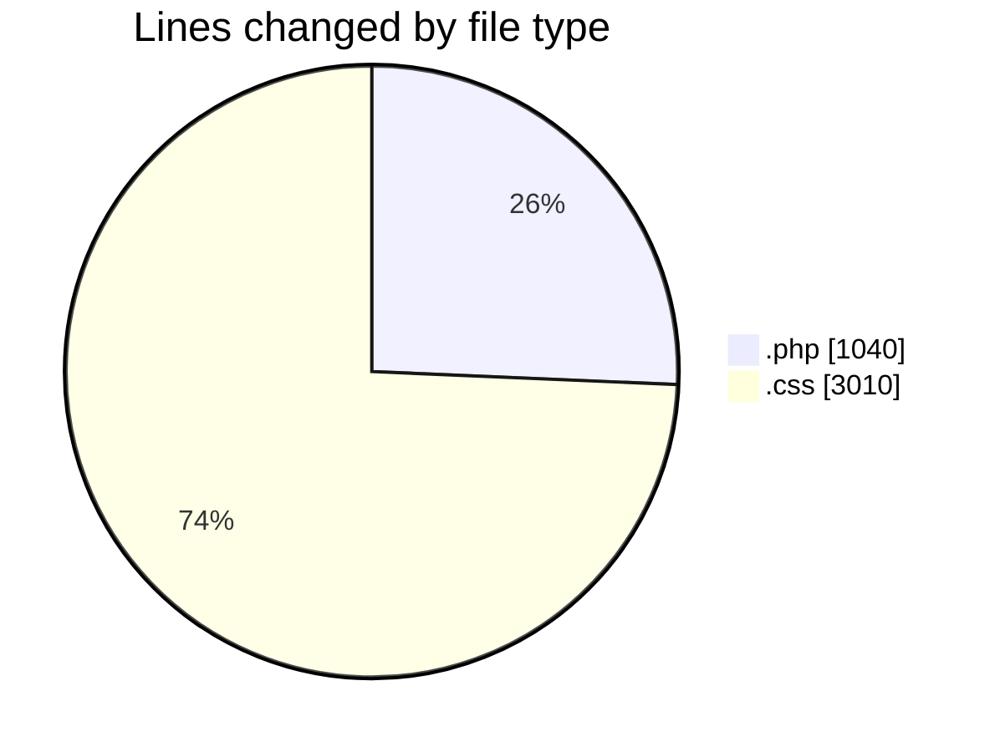
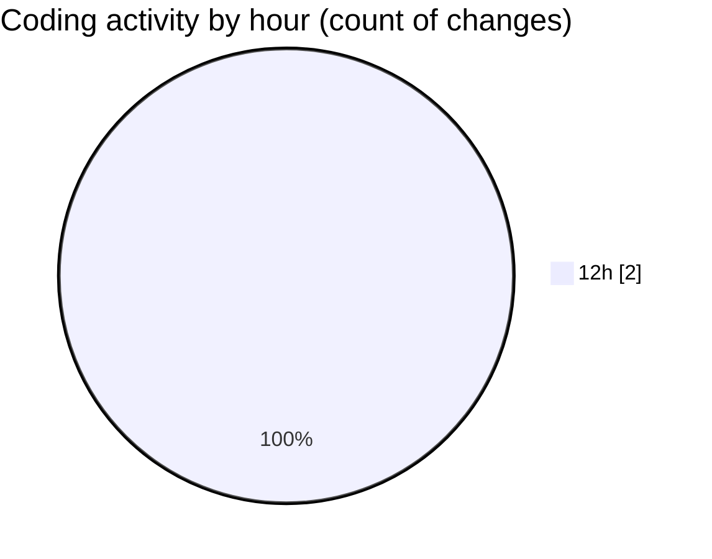

# wp-content (Workspace) - Activity Summary 

## Overall Statistics

| Stat                   | Value                                                             |
| ---------------------- | ----------------------------------------------------------------- |
| **Lines Added** (➕)   | 4050                                          |
| **Lines Removed** (➖) | 0                                        |
| **Net Change** (↕)    | 4050                |
| **Active Time** (⌚)   | 3 minutes |

## Modified Files
- **functions.php** (+1040, -0)
- **style.css** (+3010, -0)

## Visualizations

### By File Type (Lines Changed)

### By Hour (Estimated Activity Count)

> **Last Updated:** 11/10/2026, 12:53:49 PM